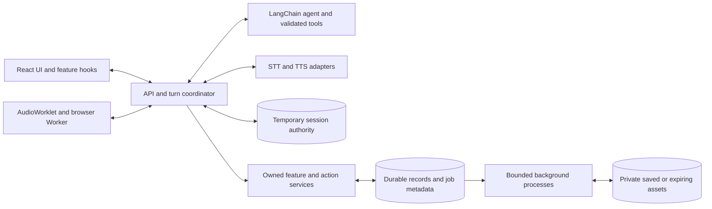

# Voice agent architecture

Status: proposed design. Only the Bun + TypeScript starter exists. [The roadmap](./roadmap.md) owns delivery status; [feature scope](./feature-ideas.md) owns approved functionality. The [interactive diagram](./architecture.html) shows the target system.

## Architecture for the full product

Use React + TypeScript with atomic UI components, Bun, a LangChain TypeScript text agent, and separate ElevenLabs STT/TTS adapters. Start with one modular backend and bounded in-memory sessions. Framework versions, the agent model/provider, speech models/voice, and hosting remain open.



Ordinary turns stay direct and asynchronous. Add durable storage and separate indexing, rendering, notification, or reconciliation processes only when their milestones require them; do not deploy every module as a service.

### Feature ownership

Conversation coordination owns admission/history/finalization; speech owns provider mapping; feature services own saved sources, profiles, budgets, schedules, and actions. Tools call validated services rather than writing another module's records directly. Retrieved content and saved prompts are data, never authorization.

### Storage defaults and privacy boundaries

| Data | Proposed storage | Policy |
| --- | --- | --- |
| Session history, ownership, deduplication, replay | Bounded memory; separate Redis before replicas | Expiring; no persistence/backups by default |
| Explicitly saved features, budgets, schedules, operations, job/outbox metadata | PostgreSQL | Authenticated owner, stated retention/removal, versioned access |
| Saved assets and temporary job media | Private object storage | Separate saved/expiring lifecycles; authorized delivery |
| Live audio | Bounded browser/server buffers | No object-store round trip or default recording |

These are defaults, not installed infrastructure. Retrieval filters by owner before search and removes derived data when a source is deleted. Do not store raw audio, full transcripts, or tool payloads in logs, accounting, or durable queues. Provider/backup retention is separate from app expiry. Detailed recovery and storage rules live in [scaling.md](./scaling.md).

## Product flow

1. Admit an authorized text or audio turn with a session/turn identity and isolated history snapshot.
2. For audio, validate and transcribe; reject empty input. Typed input skips STT.
3. Run the text agent with explicitly registered tools and bounded context, time, and iterations.
4. Commit the final answer only while ownership is current; publish text before synthesis.
5. Synthesize/play the committed answer. Speech failure preserves usable text.

M1 ends at text delivery. M2 adds the manual MediaRecorder baseline; M3 adds hands-free streaming with the same commit and cancellation rules. Never synthesize speculative intermediate model output.

## Hands-free conversation

Keep listening while the voice session is enabled. Finalize once after about 3 seconds of continuous detected silence following speech; resuming speech before submission resets the timer. Await final STT and invoke the agent once; initial silence never submits.

Confirmed new speech immediately silences playback, cancels older unfinished work, and begins a bounded new capture. Atomically invalidate the predecessor before admitting its replacement; preserve committed answers. End-session/disposal releases audio resources. Echo/noise handling and sequence barriers are defined in [browser-audio.md](./browser-audio.md#hands-free-conversation).

## Multilingual responses

Resolve language per finalized utterance and answer in that language, including Urdu, unless explicitly overridden. Support language changes and mixed input without forced English translation. Verify recognition, language detection, and synthesis independently for the selected models; uncertain/unsupported speech retains text and offers recovery.

## Selected speech provider

Use ElevenLabs standalone speech APIs through separate server adapters and its [official JavaScript SDK](https://github.com/elevenlabs/elevenlabs-js) where applicable. Select each model with its supported endpoint/transport, formats, languages, voice controls, and account eligibility; model IDs are not interchangeable across endpoints. Check the [model reference](https://elevenlabs.io/docs/overview/models) during integration.

Keep credentials server-side. Document actual speech/model-provider retention before live use; temporary app history does not imply provider zero retention. [Provider retention settings](https://elevenlabs.io/docs/eleven-api/resources/zero-retention-mode) and voice-enrollment storage require separate review.

## Contextual speech delivery

- Keep canonical text, reply language, delivery preset, and authorized speaker identity separate. Resolve bounded neutral/explanation/storytelling/calm/energetic presets from explicit request/context; manual override wins.
- Snapshot settings at final commit. Only the backend adapter maps validated presets to supported provider controls. Keep tags out of visible text/history; arbitrary user/model tags and voice IDs cannot become controls.
- Unsupported styles fall back to neutral in the same language. Preserve text if no speech combination supports it; avoid unexpected automatic replay after partial playback.
- Replay/speech retry reuses retained committed text without rerunning the agent/tools. Historical replay gets a fresh authorized playback attempt linked to the answer; recheck source/profile access rather than requiring the original turn to remain active.
- Allow one foreground audio attempt. Explicit replay/video playback replaces existing audio and suppresses pending automatic speech from already-running turns; offer their text with explicit playback. New speech or Stop cancels foreground audio immediately.

## Familiar-voice companion (planned extension)

Keep voice identity, style, and selected memories independently configurable; identify generated speech as AI. Ground memories in supplied sources, preserve original-recording provenance, and do not invent family experiences or beliefs.

Enrollment requires verified rights/provider eligibility, owner verification where required, private preview, and supported sharing. Persistent profiles/samples/memories need an authenticated owner and explicit retention/removal choices; cloning samples have separate provider storage. Verify current [cloning](https://elevenlabs.io/docs/eleven-creative/voices/voice-cloning/instant-voice-cloning), [professional ownership](https://elevenlabs.io/docs/help-center/product/voices/voice-cloning/can-i-create-a-professional-voice-clone-of-someone-elses-voice), [sharing](https://elevenlabs.io/docs/help-center/product/voices/my-voices/how-do-i-share-a-voice), and [use-policy](https://elevenlabs.io/use-policy) requirements before enrollment.

Check profile authorization/version before synthesis; revocation stops active and pending use. Distinguish removing app access from deleting an owned provider clone and report incomplete cleanup. Memory retrieval cannot change permissions.

## Explanatory videos (planned extension)

- Reuse a finalized explanation and its resolved language/voice. Verify current procedures and use genuine sanitized interface assets for tutorials; procedural lookup cannot authorize account changes.
- Render narration, captions, and highlights in a separate bounded job. [Remotion](https://www.remotion.dev/docs/renderer) is a candidate, not an installed renderer; optional video-provider API access requires separate verification.
- Give jobs their own owner, source-answer ID, generation, deadline, lease, progress, and cancellation. New voice turns do not replace them; reset/disposal or explicit job cancellation invalidates publishing rights. Stopping microphone listening leaves the job's separate cancel control available.
- Bind results to the source answer; late completion never replaces the active answer or autoplays. Keep inputs/results private and expiring; durable saving and provider upload retention require explicit choices.
- Verify source accuracy, caption readability, narration timing, Urdu RTL, failure, stale completion, cancellation, and expiry.

## Voice shopping and ticket booking (planned extension)

[Voice commerce](./voice-commerce.md) defines supported access, exact cart/itinerary approval, secure input, and independent durable operation recovery. Target providers are unverified until their specific capabilities pass integration checks. Approval of scope or a voice session does not authorize a purchase; confirmed external outcomes survive conversational interruption.

## Approved feature architecture

[Feature scope](./feature-ideas.md) defines controls/budgets, profiles/memories/originals, documents/practice/routines, reminders/actions/commerce, and videos. Reuse the coordinator, private source services, validated contracts, and explicit save/action choices. Reserve estimated paid-stage usage atomically in a durable owned ledger before account-wide budgets; cancellation may remain billable. Saved reminders need versioned schedules, IANA timezones, occurrence deduplication, and a verified delivery channel.

## Multi-agent learning extension (approved planned M10)

[M10](./agent-learning.md#m10-bounded-multi-agent-learning) follows M1–M9. Keep simple questions direct; allow a bounded supervisor, read-only research/calculator-time specialists, and advisory verifier. Validate task/results and share owner/source fences, cancellation, capacity, and budgets. The app coordinator alone commits the final answer and dispatches speech; specialist agreement never authorizes an action. Evaluation/private trace and optional MCP requirements live in [agent-learning.md](./agent-learning.md).

## Deployment and scaling

Start with one backend and temporary in-memory sessions. Add PostgreSQL/private storage and bounded workers as retained features arrive. Before replicas, introduce shared expiring session/ownership/deduplication/replay state and test authority loss, fencing, quotas, and draining. Hosting is open; [scaling.md](./scaling.md) owns deployment stages and recovery rules.

## Turn sequence

M1 uses HTTP submission, fetch-readable SSE/public events, authoritative turn status, and cancel/reset commands. M2 adds authorized binary-audio delivery; M3 adds authenticated WebSocket control/audio transport. Reconnect reads retained events/status without resubmitting. The edge must support flushing, heartbeats, bounded stream duration, and graceful draining.

Allowlist public events: `status`, `transcript`, `tool_started`, `tool_finished`, `answer_final`, `audio_ready`, `audio_error`, `cancelled`, `error`, `done`. Include session/turn/generation/event IDs; exclude raw tool payloads, secrets, and reasoning. Check ownership before every content/progress event, history write, and speech dispatch. Only the coordinator emits terminal cancellation events for the verified affected turn. Backend completion and browser playback are separate lifecycles.

## Proposed repository structure

Create modules only as their functionality arrives; this is not the current tree.

```text
apps/web/src/
  components/{atoms,molecules,organisms,templates,pages}/
  features/{conversation,voice}/       # Hooks/services; voice workers/worklets when needed
  services/                           # API client
  styles/                             # Shared tokens
apps/server/src/
  agents/                             # Factory, models, prompts
  tools/                              # One module per tool; registry.ts
  speech/                             # STT/TTS adapters
  services/                           # Coordinator, sessions, integrations
  routes/                             # Thin request handlers
  config/                             # Validated server configuration
packages/shared/src/                  # DTOs and runtime validation
```

Use Bun workspaces and strict TypeScript. Add owned feature/storage modules and workflow/worker entry points only at their milestones. Replace the root starter when working entry points and commands exist.

## Responsibilities and boundaries

| Layer | Owns |
| --- | --- |
| Atomic React components | Typed presentation, semantic controls, keyboard/focus/loading states |
| Feature hooks/services | Browser lifecycle, requests, session state, playback |
| AudioWorklet / Dedicated Worker | Bounded sample capture/playout / required conversion, VAD, framing, transport |
| API / coordinator | Validation and authentication / admission, history, cancellation, deadlines, finalization |
| Agent / tools | Text reasoning and explicit tool selection / validated bounded operations |
| Speech adapters | Provider calls, supported controls, normalized errors |
| Shared package | Browser/server schemas; no React, privileged libraries, or credentials |

Higher atomic levels compose lower levels; primitives stay presentation-focused. Frontend code never imports backend implementations or secret-bearing SDKs. Use LangChain TypeScript [`createAgent`](https://docs.langchain.com/oss/javascript/langchain/overview) with explicit registration, checked against the installed version.

## Conversation and voice state

Expose `idle`, `listening`, `recording`, `transcribing`, `thinking`, `using_tool`, `synthesizing`, `speaking`, and `error`. Derive them from separate capture, turn-processing, and playback lifecycles so listening and overlapping stages remain visible. Draft transcripts are not committed questions.

| Command | Effect |
| --- | --- |
| Finish input / `end_input` | Finalize one utterance after its ordered capture barrier |
| Cancel unfinished turn | Discard uncommitted work and reject late updates |
| Stop playback | Silence immediately; cancel remaining speech delivery, retain committed text/listening |
| End voice session | Disable listening, release media, cancel pending voice work |
| New conversation | Authoritatively reset temporary context; retained features have separate lifecycles |

- Admit one active turn per authorized session. A client-chosen ID alone is not authorization; authenticate every submission/event/status/control/audio/WebSocket route with origin and appropriate cookie-CSRF protections.
- Run each turn on an isolated history snapshot. Commit only if its turn/session generation and ownership remain current. A winning commit survives cancellation or delivery failure; transient LangChain/checkpoint state is not authoritative history.
- Cancel/reset/replacement commands carry target identity, expected generation, and deduplication ID. Atomically compare them; delayed cancellation of A must not invalidate B. A replacement invalidates its predecessor before admission.
- Use distinct session/store/turn fences, capture/playback epochs, source/profile versions, job generations, and action versions. [Ownership and recovery](./scaling.md#ownership-and-recovery) defines their lifecycles.
- Bound history and session expiry. Restart loses in-memory context; saving features requires separate authenticated ownership and retention choices.

## Initial tools and extension model

| Tool | Validated input | Result |
| --- | --- | --- |
| `calculate` | Explicit arithmetic operation and finite numbers | Finite result or controlled error, including zero division/overflow |
| `get_current_time` | IANA timezone | Current date/time and timezone |

Use LangChain's [`tool` helper](https://docs.langchain.com/oss/javascript/langchain/tools) with Zod, stable snake_case names, documented results/errors, cancellation, deadlines, and size limits. Register each module in `registry.ts`; never evaluate user expressions as code. External APIs stay behind services. Input/retrieved content cannot alter tools or permissions; side effects require server-enforced exact approval and reconciliation.

## Failures and recovery

- Capture/STT failure keeps typed input available; model/tool failures report controlled errors; synthesis/playback failure preserves finalized text.
- Uncertain submission retries reuse the same turn ID and payload. Confirmed terminal failure/cancellation permits an explicit new turn ID; speech retries reuse committed text. Never rerun the agent on event disconnect.
- Retain minimal deduplication independently of history/events for a bounded server-verifiable retry horizon; reject expired retries rather than admitting forgotten IDs as new work.
- Expired replay first queries authoritative status: recover the committed answer or observe the same running turn. Lost/expired session authority cannot be recreated silently. Durable external-operation recovery is independent of temporary turns.

## Performance and reliability

- Bound payload/audio/history/context, per-stage and total duration, tool iterations, provider concurrency, and event/socket/playback queues. Reject overload predictably and reuse provider clients.
- Protect interactive provider capacity from jobs across all replicas/pools. Count cancelled upstream work until settled or conservatively reconciled; local stop alone does not free paid capacity.
- Stream STT during capture and TTS after final commit when supported. Keep binary audio out of JSON events; use explicit backpressure, transferable buffers, compact React updates, and immediate local stop per [browser-audio.md](./browser-audio.md).
- Measure silence/seal, STT, agent/tools, commit, synthesis, first audible audio, queue sizes, and p50/p95 independently. Use correlated monotonic timings; verify representative devices, concurrency, slow clients, failure, and cancellation before targets/replicas.
- Log bounded identifiers, durations, and sanitized errors. Disable content tracing by default; no vendor or private-content retention is implicitly selected.

## MVP completion criteria

M3 completes the core; [roadmap gates](./roadmap.md) define each earlier release. Verify spoken/typed turns, real calculator/time tools, isolated follow-up context, 3-second silence, interruption without stale history/audio, Urdu/language changes, delivery overrides/fallbacks, provider failures, cleanup, and accessible atomic UI. Run mocked end-to-end flows, then a real microphone/playback check with configured providers. No provider credentials may reach the browser.

## Decisions to make during implementation

| Due | Open decision |
| --- | --- |
| M1 | Compatible framework versions/API framework, agent provider/model, authenticated contracts, limits, retention, runnable checks |
| M2–M3 | Speech endpoint/model/voice, Urdu coverage, formats/streaming, VAD/echo/decoder support, real-device behavior |
| M4–M6 | Stable owner, durable budget ledger, saved storage/retention/removal and bounded indexing |
| M7–M8 | Notification/commerce capabilities, exact approval, durable dispatch/reconciliation |
| M9 | Renderer/runtime, verified assets, private expiry, narration/render capacity |
| M10 | Role/contracts/limits, baseline comparisons, private evaluation/traces, optional MCP verification |
| Deployment | Host/region/edge, measured limits, shared authority/replay and recovery before replicas |
