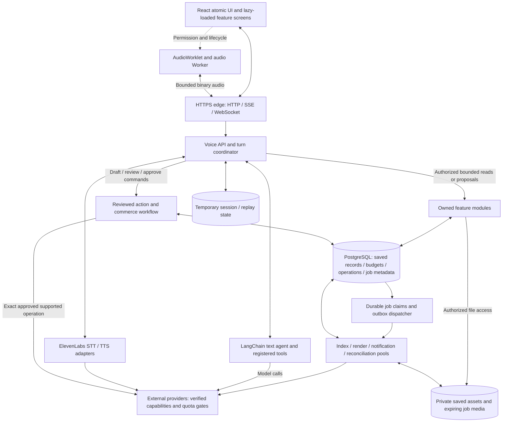
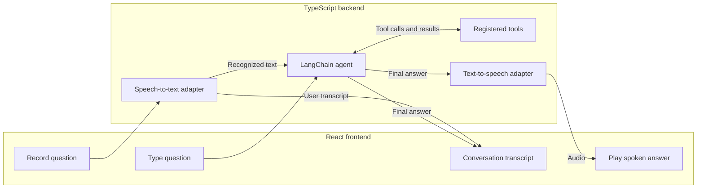
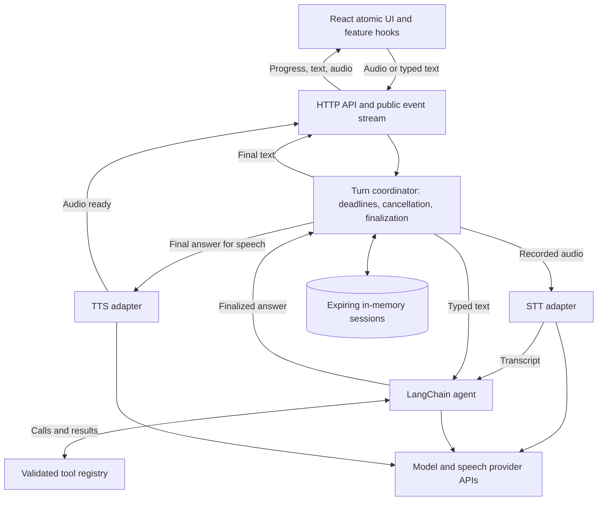
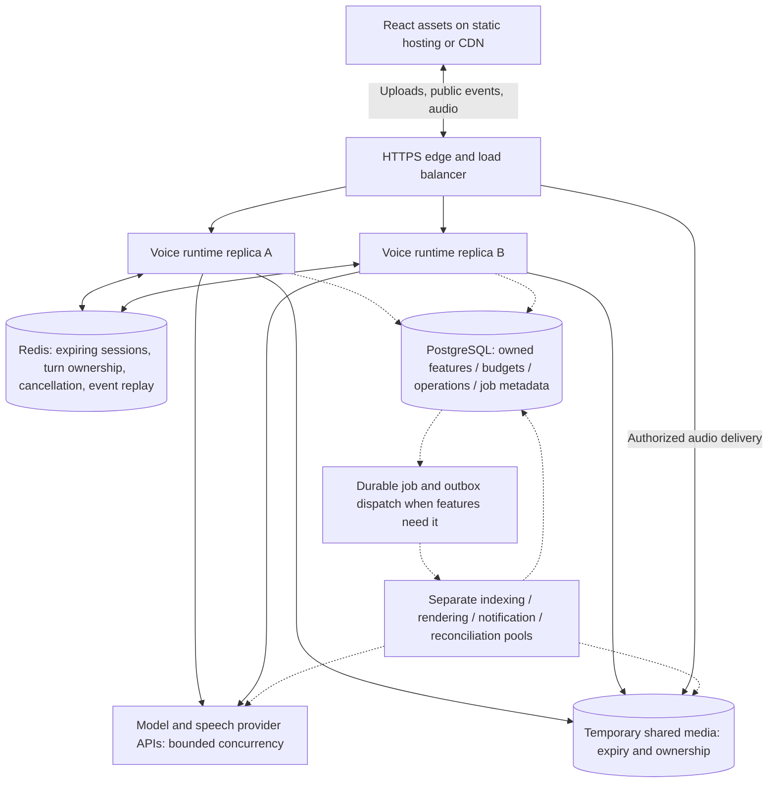
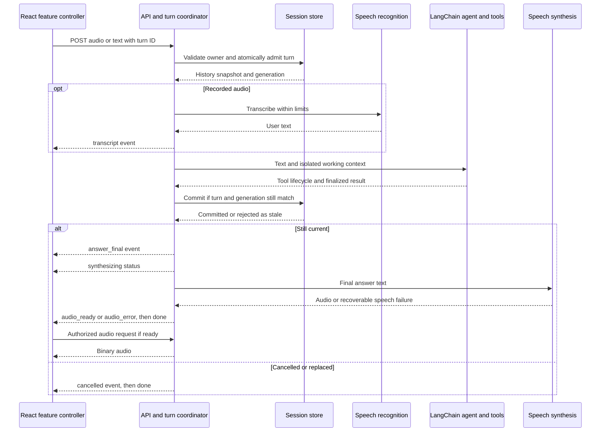

# Voice agent architecture

Status: proposed design for the approved phased project scope. Only the Bun + TypeScript starter exists today. React with atomic design and LangChain are required; ElevenLabs is selected for speech recognition and synthesis. The remaining choices below are starting defaults.

Follow [the delivery roadmap](./roadmap.md) for implementation batches and release gates: M1 builds the text foundation, M2 establishes manual voice, and M3 completes the core hands-free MVP before the approved extensions. The roadmap tracks progress; this document defines design boundaries.

Open [the interactive diagram](./architecture.html) in a browser to explore the full feature system, hands-free browser audio threads, the manual baseline, scaled deployment, and atomic React structure. [Browser audio execution](./browser-audio.md) defines the AudioWorklet and Web Worker boundaries.

## Architecture for the full product

Build one modular TypeScript backend first, with separate processes for expensive or scheduled work as those features arrive. React uses feature hooks and atomic components; LangChain owns text reasoning and registered tools; ElevenLabs stays behind independent STT/TTS adapters. The proposed durable feature database is **PostgreSQL**, the proposed shared temporary session store is **Redis**, and saved/expiring files use **private object storage**. These are design defaults, not installed infrastructure or a selected hosting vendor.

Separate three execution paths: direct interactive turns, owned feature/action workflows, and bounded background jobs. Each has its own admission limits and lifecycle. Video rendering or indexing must not occupy the voice event loop or exhaust its model/speech capacity. [Runtime and scaling design](./scaling.md) specifies scheduling, recovery, storage, capacity controls, and rollout gates.

The diagram shows the target after the relevant roadmap milestones, not the initial deployment:



The voice runtime and worker pools share feature services and contracts, not in-process queues or a global conversation object. Browser access never exposes provider credentials. Pools are separate process entry points in the same backend codebase; splitting every feature into a network service is unnecessary until measured load or deployment needs justify it.

### Feature ownership

| Module | Owns | Important dependency |
| --- | --- | --- |
| Conversation and turn coordinator | Temporary history, turn admission, final commitment, progress and cancellation | Session authority; speech and agent adapters |
| Speech and preferences | Model/language capabilities, delivery, playback settings, pronunciation | Validated presets and current authorized profile |
| Companion and original library | Authorized voice identity, separate persona, authentic recordings/letters | Stable owner, explicit retention, provider eligibility/revocation |
| Selected memories and documents | Source versions, private retrieval, citations and deletion | Owner-filtered queries and bounded indexing |
| Practice and routines | Visible topic/mode/difficulty and saved editable prompts | Existing agent permissions and one-turn admission |
| Budgets and provider capacity | Estimated reservations, confirmed usage, limits by workload/provider | Atomic accounting; interactive capacity protected from jobs |
| Reminders and agenda | Versioned schedules, occurrence creation and delivery state | Durable scheduler and verified notification channel |
| Actions and commerce | Exact reviewed payload, approval, operation and receipt/reconciliation | Independent durable state; verified provider adapter/handoff |
| Videos | Finalized source answer, storyboard/assets, render job and private result | Expiring job input, source validation and bounded render pool |

Each module has services and storage adapters behind thin handlers. Tool definitions stay in `tools/`, agent construction in `agents/`, and speech integrations in `speech/`. A tool invokes a validated feature service; it cannot write another module's tables directly or bypass approval. Retrieved content and saved routines remain data. Add feature flags/capability checks for integrations as they are implemented, so an unavailable extension leaves core voice usable.

### Storage defaults and privacy boundaries

| Data | Proposed authority | Lifecycle |
| --- | --- | --- |
| Conversation history, active turn/fence, public replay | Bounded in-memory store first; shared Redis before replicas | Temporary, expiring; no persistence/backups by default |
| Saved profiles, preferences, memories, originals, documents and routines | Owned PostgreSQL records with private object references | Only explicit saved/enrolled data; versioned access and removal |
| Budgets, reminder schedules/occurrences, exact action operations and minimal receipts | PostgreSQL transactions and unique constraints when introduced | Stated operational retention; no transcript/audio content needed in accounting |
| Job/outbox metadata | PostgreSQL rows initially; optional separate durable broker later | Minimal owned references, deadlines, attempt/fence and terminal state |
| Live audio | Bounded browser/server buffers and provider connection | Released after use; no object-store round trip on live playback |
| Saved media and expiring job inputs/results | Private object storage with separate retention classes | Explicit saved assets versus short-lived output; revoke app access and track cleanup |
| Document search data | Owner-filtered PostgreSQL search; evaluate a vector extension only when needed | Derived from approved sources; source version and deletion apply to every index/cache |

PostgreSQL is the proposed durable default; select its hosting, retention, query/index strategy, and authentication integration during implementation. Do not add a separate vector database before retrieval measurements require it. Apply owner filters before searching; optional database row policies supplement server authorization, using roles that cannot bypass those policies. [PostgreSQL row security documentation](https://www.postgresql.org/docs/current/ddl-rowsecurity.html) describes the role/owner exceptions that must be accounted for.

Durable work must not share the temporary Redis instance's retention policy. Redis persistence is instance configuration, so using another key prefix/database does not isolate durable job writes from temporary transcripts. Use PostgreSQL job/outbox records initially or a separately configured durable broker later. [Redis persistence documentation](https://redis.io/docs/latest/operate/oss_and_stack/management/persistence/) describes disk snapshots, write logs, and disabling persistence.

Do not place raw audio, full transcripts, or full video narration in durable queue messages, operational logs, or accounting rows. A requested video may use a private expiring input object; durable metadata holds its reference and expiry. Signed file URLs have bounded lifetimes; use an authorization-checked delivery path when immediate revocation is required. Explain backup/provider retention for saved assets separately from access revocation.

## Product flow

The intended voice experience is hands-free after the user starts a voice session: submit an utterance after about 3 seconds of silence, stay ready for the next question, and interrupt the reply when the user speaks again. Build the manual record-and-submit baseline first as an integration milestone and fallback. The speech pipeline separates speech recognition, a text-based agent, and speech synthesis, following the [LangChain voice agent guide](https://docs.langchain.com/oss/javascript/langchain/voice-agent). The streaming target keeps that agent boundary while overlapping capture with transcription and synthesis with playback.

The diagrams and turn sequence below label the initial batch baseline. The [browser audio design](./browser-audio.md) adds the streaming target: main-thread React controls, AudioWorklet sample processing, and a Dedicated Worker for necessary conversion and bounded transport. These are complementary browser execution contexts, separate from backend job workers. Actual speedups depend on the device, network, and providers.



One turn works as follows:

1. The user records a question or submits text. The frontend associates the request with the current session and a new turn ID.
2. For recorded audio, the backend validates format and size, then transcribes it. Empty transcription produces a recoverable error.
3. The backend passes the text and session history to the LangChain agent.
4. The agent answers directly or calls registered tools. The frontend shows relevant progress and tool activity.
5. The backend returns the final answer text and synthesizes speech. The interface displays the answer even if speech synthesis fails.
6. The frontend plays the audio, then returns to idle. Follow-up turns reuse the same session context.

Publish final answer text before waiting for speech synthesis. The baseline can return a complete synthesized audio clip. The streaming target instead plays provider audio chunks as they arrive after the same final-text commit, avoiding the wait for the whole clip. Streaming model text into speech before the answer is finalized remains a separate later optimization requiring an explicit final-response phase and partial-response history semantics. Model text emitted before a tool call must not be mistaken for the final answer.

## Hands-free conversation

1. **Start voice session** requests microphone access and shows a listening indicator. Keep the microphone ready between questions, during processing, and during playback until the user ends the session, except for the explicit secure-input pause in the commerce flow.
2. Detected speech starts an utterance and draft transcription. After about **3 seconds of continuous detected silence**, send `end_input`, await the final transcript, and submit it once. Speech before that boundary resets the timer and continues the same question. Initial silence never submits a turn.
3. Speech after that boundary starts a new utterance. Immediately stop any reply audio and cancel older unfinished generation or remaining synthesis/delivery. Capture the new speech into a bounded buffer while the server atomically invalidates the previous turn before admitting its replacement.
4. Preserve answers that were already committed. Ignore old transcript, answer, and audio events after interruption. Return to listening after each reply; **End voice session** releases the microphone and cancels remaining voice work.

The 3-second threshold is a configurable product default, measured from speech activity rather than transcript arrival. It marks end-of-input; provider finalization and answer generation take additional time. Speech detection must distinguish the user's voice from background noise and the assistant's playback. The [browser audio plan](./browser-audio.md#hands-free-conversation) defines timing, buffering, echo handling, and failure checks. Manual finish/cancel controls and typed input remain available.

## Multilingual responses

Detect the language of each finalized utterance and produce both visible and spoken answers in that language, including Urdu, unless the user explicitly requests another language. Use reliable language metadata from STT when available; otherwise resolve the language from the final transcript and session context. Handle language changes between turns and mixed-language speech without automatically translating everything into English.

Pass the reply language as turn context to the text agent, then select a speech model/voice that supports the finalized answer's language. Target broad coverage rather than promising every language: verify recognition, automatic detection, and synthesis separately for each chosen model. If detection is uncertain or speech support is unavailable, expose a language choice or typed fallback and preserve the text answer. Urdu and language-switching checks are required before accepting the selected speech models for voice use.

## Selected speech provider

Use ElevenLabs standalone STT and TTS APIs behind separate backend speech adapters, with the official `@elevenlabs/elevenlabs-js` SDK where applicable. LangChain remains responsible for the text agent and tool calls. The coordinator retains ownership of turn admission, final-answer commits, cancellation, and speech dispatch.

Choose the baseline transcription model, streaming transcription model, synthesis model, and voice during integration. Verify language coverage, audio formats, runtime compatibility, and interruption behavior against the selected models. Keep the ElevenLabs API key on the server. Integration setup, environment placeholders, and real voice validation are still pending.

Select a model together with its supported API/transport, output format, language set and voice capabilities. A model ID is not interchangeable across endpoints: the current documentation exposes Eleven v4 through Text to Dialogue and v4 Turbo through the [realtime dialogue WebSocket](https://elevenlabs.io/docs/eleven-api/guides/how-to/websockets/realtime-tdd). The backend synthesis adapter may use either supported speech/dialogue API while retaining one authorized speaker and the same final-answer boundary. Verify the installed SDK path and account eligibility before enabling it; these models remain candidates, not configured choices. See [the model reference](https://elevenlabs.io/docs/overview/models).

Temporary app history describes our own storage, not provider retention. ElevenLabs retains API content by default; eligible enterprise configurations can enable [Zero Retention Mode](https://elevenlabs.io/docs/eleven-api/resources/zero-retention-mode) for supported endpoints. Document the selected speech and agent providers' actual retention/settings before live integration, and do not claim zero retention solely because app logs/history are temporary. Cloning has its separate storage exception below.

## Contextual speech delivery

The expanded scope adds delivery that adapts to the request and conversation context. Start with a small set of presets:

| Preset | Example context | Intended delivery |
| --- | --- | --- |
| `neutral` | Facts, calculations, time, or uncertain context | Clear, concise, restrained |
| `explanation` | Teaching or step-by-step guidance | Patient pacing and useful pauses |
| `storytelling` | A story or character narration | Expressive emphasis and narrative pacing |
| `calm` | The user requests a gentle tone | Warm and measured |
| `energetic` | The user requests excitement or celebration | Lively delivery |

These presets are app metadata, not promised provider tag names. Resolve them from the current request/agent context without a separate agent run solely for styling. A manual style selection wins; in Auto mode, honor an explicit delivery request before inferring a preset from context. Provide Auto and Neutral options so the user can keep ordinary delivery. The selected speaker voice remains stable; choosing another voice is a separate user-controlled setting, validated against the voices available to that session.

Keep the canonical final answer, reply language, delivery preset, and voice profile separate. Snapshot the resolved settings when finalizing the answer, then publish the original text. After final commit, the backend speech adapter maps validated presets to supported model controls and creates the speech input. Keep provider delivery tags out of conversation text/history and do not treat arbitrary bracketed user, tool, or model text as authorized controls. Mid-turn setting changes apply to future answers unless the user explicitly requests a speech retry.

Evaluate the Eleven v4 family for expressive speech using its [documented audio controls](https://elevenlabs.io/docs/help-center/product/core-capabilities/text-to-speech/how-do-audio-tags-work-with-eleven-v3-and-v4). Verify expression, voice compatibility, Urdu/mixed-language output, and the chosen streaming endpoint separately. If a preset is unavailable, use neutral delivery with a model/voice that supports the same reply language. If no configured combination supports that language, keep the text answer and report speech unavailable. If playback has already begun, offer an explicit retry instead of automatically replaying the answer in another style.

Style preparation, synthesis, fallback, and replay use the existing ownership, turn/generation, and playback-attempt checks. New speech must silence expressive playback immediately; a late style or synthesis result cannot restart an interrupted answer. Speech retry uses the committed text without another agent run. Contextual delivery uses existing authorized profiles; voice enrollment is a separate opt-in extension below.

Replay of an older committed answer creates a fresh playback attempt under the current authorized session, linked to the source answer ID. Validate the answer's continued availability, current profile access and resolved supported settings; gate this attempt by its own playback epoch and the current session generation rather than requiring the original turn to remain active. Do not advance the original answer's generation or rerun its agent/tools. New speech or Stop playback cancels this attempt; concurrent generation remains governed by its own turn. Normal automatic speech from a completing turn still requires that turn to be current. Expired/reset conversation answers cannot be replayed from client-supplied text as if they were retained server records.

Allow only one foreground audio playback attempt. An explicit replay or video-play action replaces existing playback and suppresses pending automatic speech from any already-running turn; publish that turn's final text and offer explicit playback instead. Do not queue it to speak unexpectedly when the chosen audio ends. New user speech interrupts foreground audio and can start a new turn with normal automatic speech eligibility.

## Familiar-voice companion (planned extension)

The user has requested an AI companion using an authorized loved one's voice. Keep voice identity, conversation style, and saved memories separate. Clearly identify generated interactions as AI; original recordings and supplied quotations retain their provenance. Do not present invented family events, personal opinions, or generated memories as facts about the real person. When supplied context does not contain a memory, say so.

Implement deliberate enrollment and private preview, then let the user choose the profile for a session. Verify voice-use rights and current provider requirements before uploading samples or importing a shared voice. [Instant cloning](https://elevenlabs.io/docs/eleven-creative/voices/voice-cloning/instant-voice-cloning) requires rights/consent confirmation. [Professional cloning](https://elevenlabs.io/docs/help-center/product/voices/voice-cloning/can-i-create-a-professional-voice-clone-of-someone-elses-voice) requires the voice owner to create and verify their own clone; review [sharing rules](https://elevenlabs.io/docs/help-center/product/voices/my-voices/how-do-i-share-a-voice) before offering cross-account sharing. Memorial use needs a check of the current [provider policy](https://elevenlabs.io/use-policy) and applicable rights; do not promise that archived samples qualify for Professional verification.

Voice enrollment is an explicit exception to temporary conversation storage. Explain that cloning samples require provider retention and are excluded from [Zero Retention Mode](https://elevenlabs.io/docs/eleven-api/resources/zero-retention-mode). Persistent app profiles require a stable authenticated owner and record the provider voice reference, authorization status, allowed users, and lifecycle/version. Do not persist raw samples in the app by default after enrollment; track provider cleanup/removal outcomes separately.

Check profile ownership, authorization, and current version on the server before synthesis. Revoking a profile's access must stop active use and invalidate pending speech for that profile. Provide app-access revocation and profile removal; request provider deletion only for clones the account owns and report pending/failed cleanup accurately. Profile changes remain separate from contextual style selection.

Allow optional selected memories, stories, or original recordings only after an explicit save/upload choice. Give entries an owner, provenance, editable/deletable content, and an expiry/retention setting. Memory retrieval is read-only context for the agent; it cannot change the system prompt, tool permissions, or the final-answer commit rules. Conversation history remains temporary unless a separate retention choice is made. Verify access isolation, memory grounding, revocation during synthesis, provider failure, and removal behavior before enabling this extension.

All previously suggested additions are now approved planned scope in [the feature roadmap](./feature-ideas.md). Its phases preserve a first working voice milestone; new unapproved ideas are listed separately.

## Explanatory videos (planned extension)

Add on-demand explanatory videos after the core voice flow. A request such as “Explain how to cancel an IRCTC ticket with a video” creates a narrated walkthrough in the user's reply language. Use read-only access to procedural sources; actual ticket actions would require a separate authorized integration.

1. Verify the procedure against current official sources and the relevant case. For IRCTC, ticket status, timing, and applicable train/refund rules matter; retain source links and a checked-at timestamp. The [official refund rules](https://contents.irctc.co.in/en/RefundCancellationRules.pdf) are a reference, not a substitute for checking the current interface and the user's situation.
2. Finalize the text answer and create a validated storyboard from it. Use genuine public/demo or user-authorized screenshots/recordings with personal details removed. Add step highlights and readable captions; do not generate fictional interface buttons or present an unverified refund amount as fact.
3. Generate ElevenLabs narration using the resolved language, voice profile, and explanatory delivery. Assemble timed visuals, captions, and audio with a renderer; [Remotion](https://www.remotion.dev/docs/renderer) is the initial candidate, with runtime and deployment compatibility to be verified during implementation.
4. Render in a separate bounded background job and return progress plus a private expiring video URL when ready. Give the spoken/text answer before waiting for video rendering. Playback is user-initiated.

Use a separate job ID, owner/session ID, source-answer ID, per-job generation, and explicit `queued`, `running`, `completed`, `failed`, and `cancelled` states. The job generation is independent of voice-turn/playback epochs. Starting another voice turn must not rerun or replace an existing video job; show its result against the original request. Reset/disposal or explicit video cancellation invalidates its publishing rights and propagates cancellation where supported. Stopping voice playback or ending microphone listening leaves the video job under its separate cancellation control. A late job result cannot replace the current answer or autoplay. Bound render concurrency, duration, resolution, asset bytes, and temporary storage; add an actual queue only when this feature is implemented.

Default to private temporary app assets and outputs with expiry, no transcript/raw-capture logging, and no automatic durable retention. Saving a video is an explicit retention choice. Review external providers' media retention separately before uploading private material. If instructions or visuals cannot be verified, explain the limitation and retain the usable text answer. Check caption readability and audio/visual synchronization, including Urdu right-to-left text, and cover failed rendering, stale completion, cancellation, and expired results.

ElevenLabs' [Image & Video API](https://elevenlabs.io/docs/eleven-api/guides/cookbooks/image-and-video) can supply generated clips but currently requires Pro or above and may take minutes. Website video access and video API eligibility are separate. This API is optional for the screenshot-based rendering path; no video provider, renderer, queue, or storage integration is installed yet.

## Voice shopping and ticket booking (planned extension)

The user has approved voice-initiated shopping and ticket booking in Phase 4. Initial target services are Flipkart, Blinkit, Zepto, and IRCTC/authorized ticketing partners. Resolve the request, compare supported results, obtain a current quote where possible, and present an exact cart/itinerary for explicit user confirmation. The [commerce design](./voice-commerce.md) specifies provider readiness, secure checkout, and acceptance checks; no integration is implemented.

Keep the first milestone to local draft preparation plus a supported provider handoff or one verified buyer/booking adapter. Seller, affiliate, catalog, and consumer checkout APIs are distinct; do not claim universal direct purchasing from the target list. Expose supported capabilities and gate every external mutation on current account ownership and exact-payload approval. Recheck inventory, fare/price, fees, address/passenger details, terms, and approval expiry before execution; material changes require fresh review.

Pending confirmation and payment/authentication belong to an independently owned action workflow, not an indefinitely running voice turn. Pause microphone capture, transcription forwarding, and playback during secure provider input; invalidate pending input/silence timing and resume listening only through a valid user action. Passwords, OTPs, card security codes, and payment PINs stay outside model/transcript context. Purchase budgets are separate from speech/model/video budgets. Saving addresses/travellers is opt-in.

Use durable operation IDs/versions, atomic one-time approval consumption, idempotency and verified status reconciliation. A network timeout or voice interruption does not prove that a purchase failed. Preserve externally confirmed outcomes against the original operation without changing the current conversation or replaying late audio. Order/booking, seat, payment, and refund status remain distinct. Cancellation/refund of an existing transaction requires its own supported, reviewed operation.

## Approved feature architecture

The user has approved every feature in the [phased roadmap](./feature-ideas.md). Keep one modular backend and add feature hooks/services as working functionality is built. The core voice MVP stays the first milestone; approval of the wider scope is not a claim that these extensions exist today.

| Feature group | Boundary and behavior |
| --- | --- |
| Answer/playback controls and transcript correction | Pages connect feature hooks to accessible controls. Replay uses retained audio or re-synthesizes committed text without rerunning tools. A corrected question starts a new turn linked to the original; it does not silently rewrite an already finalized answer. |
| Pronunciation preferences | Validate model-supported dictionaries/control formats in the speech adapter. Preview and remove preferences; keep provider markup outside canonical text and preserve the requested language. |
| Usage and budgets | Estimate STT, model, TTS, and video usage on the server. Reserve budget atomically across admitted turns/jobs, bound provider concurrency, and reconcile provider-reported usage when available. Label estimates, units, and update times separately from confirmed charges. A local budget is not a guarantee of the provider's final invoice, and cancellation can still incur charges. |
| Companion, saved memory, and original messages | Use private owned records as defined above. Keep authentic playback/quotes distinct from AI narration. Explicit saves have retention/removal controls; conversation history stays temporary. |
| Personal document answers | Validate file formats/size, then parse/index in bounded jobs when required. Apply owner/access filters before retrieval, cite page/section passages, and recheck source versions before publishing. File contents are data and cannot grant permissions. Removal covers originals, extracts, indexes/embeddings, and caches; stale indexing must not recreate deleted content. |
| Tutor/practice modes and routines | Reuse the same LangChain agent and speech adapters with explicit mode/topic/difficulty settings. Saved prompts are previewable and editable; running one admits one turn. Exiting a learning mode restores ordinary context. A saved routine does not pre-authorize external actions. |
| Timers/reminders and agenda | Use an owned scheduler and verified delivery channel for saved reminders. Store intended local time, IANA timezone, resolved instant, recurrence policy, and expiry. Handle ambiguous times, snooze, cancellation, restart, overdue items, and duplicate delivery. Explain which mode works with the app closed; browser timers alone do not establish that capability. |
| Reviewable external actions | Present exact validated destination/parameters and relevant consequences in an action card. Server execution requires explicit approval tied to that card's owner, version, payload, and scope. Editing invalidates approval. Use idempotency and reconcile uncertain results before retrying; cancellation does not undo a completed external change. |
| Shopping and booking | Use the separate commerce/action workflow above. Provider discovery, quote/cart, payment, purchase/booking, tracking, cancellation and refund capabilities are verified independently; unsupported execution becomes a labelled handoff. |
| Explanatory videos | Use the separate source-checked, owned background job and media lifecycle above. Preserve immediate voice/text answers and require user-initiated video playback. |

When implementing retained features, add a durable owned feature store separately from expiring session/event state. Profiles, selected memories/recordings/documents, saved routines, reminders, and required operation/receipt references need stated retention/removal policies, including backups and provider cleanup. Optional saved addresses/travellers require an explicit choice. PostgreSQL is the proposed database default; the deployment/provider is still to be chosen and no store is installed. Saving one item does not save every conversation or enable raw-audio logging. Durable conversation history remains a separate user choice.

Saved reminder ownership is independent of a voice turn's generation. Microphone stop, conversation reset, or screen unmount must not silently delete a saved reminder; cancel it through its own validated control. Temporary turns and render/indexing attempts still invalidate on disposal/reset as appropriate. Budget exhaustion or a failed side feature must leave finalized conversation text usable. Text fallback is available only within any remaining model allowance.

Shared contracts cover versioned preferences, upload/source references, usage estimates, reminder schedules, and action-card/job states. Keep public output allowlisted and normalized. User-provided routines, memories, and retrieved files cannot change server tool registration or authorization. Add concrete tool integrations only when their feature is implemented, with the existing validation/deadline and ownership rules.

Commerce contracts additionally cover normalized product/fare references, local cart/booking drafts, quote freshness/expiry, amounts/currency, exact approval scope, secure-handoff state, and minimal verified receipts. Raw provider payloads and payment credentials are not public progress events. Product descriptions and provider pages are untrusted data and cannot grant approval or change tool permissions.

The roadmap supplies feature-specific acceptance checks. In addition to core voice checks, verify private retrieval/deletion, recurrence and delivery deduplication, concurrent budget reservation, exact action approval, duplicate/uncertain action outcomes, and failure recovery. New suggestions such as conversation search and extra accessibility settings remain outside approved scope until selected; basic keyboard access and semantic UI stay required.

## Deployment and scaling

Start with one modular backend process. The boundaries below allow later replicas without creating separate services for every component.

### MVP: one backend



The coordinator owns the whole turn. It snapshots history, enforces limits, projects internal events to public events, commits finalized context, and dispatches speech. The agent and speech adapters remain independent modules. This deployment has one backend replica and loses temporary state on restart.

### Scale: shared state before replicas



Each replica contains the same API, coordinator, agent, tools, and speech adapters. Replicas share session history and turn metadata rather than relying on process-local memory or sticky routing for correctness. Live streams and provider requests still belong to the process serving that turn. Add durable stores and workers only as their features arrive; they may precede voice replicas. Provider capacity is bounded across voice and worker pools, with capacity reserved for interactive work.

| Concern | MVP | Before or during horizontal scaling |
| --- | --- | --- |
| Session context | Bounded memory with expiry | Redis session adapter with bounded history and TTL |
| Active turn | Local turn ID and generation | Atomic admission, renewable ownership lease, and fencing/version checks |
| Event delivery | Bounded local replay buffer | Bounded expiring Redis Streams; resume by event ID without rerunning the agent |
| Cancellation | Local abort controller | Shared cancelled generation plus notification to the owning replica |
| Answer audio | Bounded temporary local bytes for baseline; bounded live buffers for streaming | Stream directly from the owning runtime; shared temporary media only for baseline clip delivery or an explicit replay feature |
| Slow jobs | No queue for ordinary voice turns | Add durable job/outbox claims and isolated worker pools for required features; saved reminders use their owned scheduler |
| Saved feature records | None in the initial voice milestone | Add owned PostgreSQL storage when account budgets, profiles, memories, documents/routines, or reminders are implemented, even with one replica |
| Durable history | Disabled | Optional database/checkpointer after a retention decision |

Redis is a proposed shared-state choice, not an installed dependency. Its [Streams](https://redis.io/docs/latest/develop/data-types/streams/) provide IDs and trimming for bounded replay; short [atomic scripts](https://redis.io/docs/latest/develop/programmability/eval-intro/) can check the current generation when admitting or committing work. If Redis state is lost or ownership becomes uncertain, fail the active turn safely rather than silently recreating it. Adding replicas does not increase upstream provider quotas.

Leases and generation checks do not make asynchronous Redis failover an exactly-once execution guarantee. Include a store-incarnation identifier, invalidate old sessions/owners after detected authority loss, and reject uncertain ownership. Protect retained operations separately with durable unique records and provider idempotency/reconciliation. See [Redis's distributed-lock failure caveat](https://redis.io/docs/latest/develop/clients/patterns/distributed-locks/) and [the recovery design](./scaling.md#ownership-and-recovery).

Configure the temporary session/event store without disk persistence or backups unless an explicit retention decision permits them. Expiry alone does not define backup retention. Saved feature records use their separately chosen durable retention policy; durable conversation history is a separate feature.

The shared media store in the scale diagram serves completed audio clips when that mode is enabled, and private expiring video outputs when the video extension is added. Live audio does not need to wait for an object-store write/read. A WebSocket connection belongs to its serving replica; use graceful draining and explicit turn failure/retry on a broken live audio stream rather than claiming seamless migration. Shared context enables subsequent turns to use another replica. Keep media bytes out of Redis event replay; replay only retained control/transcript/job-status events.

## Turn sequence



Cancellation may occur at any phase; validate ownership and turn state before every public event, context write, and speech dispatch, not only at the final commit. The coordinator records cancellation and emits terminal `cancelled`/`done` events for the affected turn; late provider work cannot emit further content or audio. A TTS result arriving after cancellation is discarded. Stopping playback silences local audio immediately and cancels any remaining synthesis or delivery while keeping the already finalized answer.

The baseline transport is HTTP POST for audio or typed text with a fetch-readable SSE response for public events, a session-authorized HTTP audio endpoint, and a separate cancellation request. SSE reconnects use a read-only event endpoint with the turn ID and last event ID; reconnection must never resubmit the turn. The streaming target adds a session-authorized WebSocket connection for typed control messages and binary audio chunks, described in [browser-audio.md](./browser-audio.md). Define concrete route paths and schemas during scaffolding.

Public events are an allowlist: `status`, `transcript`, `tool_started`, `tool_finished`, `answer_final`, `audio_ready`, `audio_error`, `cancelled`, `error`, and `done`. Include session ID, turn ID, generation, and event ID. An audio failure is separate from a model failure so the final text remains usable. Publish public tool labels/status rather than raw arguments or results. The `done` event marks backend turn completion; browser playback has its own lifecycle and may still be pending or active.

The edge should support HTTP/2 for HTTP traffic, allow SSE flushing without response buffering, send heartbeats, and permit bounded stream durations. Use one active SSE stream for the current baseline turn and close it at completion. [MDN's SSE guide](https://developer.mozilla.org/en-US/docs/Web/API/Server-sent_events/Using_server-sent_events) explains the transport and browser connection limitations. Enable WebSocket upgrades and suitable connection limits for the streaming target. Evaluate WebRTC later if full-duplex media, network conditions, or provider support justify it.

## Proposed repository structure

Create these directories as their functionality is implemented. This tree describes the target layout, not files that already exist.

```text
ai-agent/
├── apps/
│   ├── web/
│   │   └── src/
│   │       ├── components/
│   │       │   ├── atoms/
│   │       │   ├── molecules/
│   │       │   ├── organisms/
│   │       │   ├── templates/
│   │       │   └── pages/
│   │       ├── features/
│   │       │   ├── voice/          # Controller, recording/playback, worker bridge
│   │       │   │   ├── workers/   # Dedicated Worker: conversion, framing, transport
│   │       │   │   └── worklets/  # AudioWorklet: bounded capture and playout
│   │       │   ├── conversation/   # Session state and turn orchestration
│   │       │   ├── companion/      # Later: profiles and explicit selected memories
│   │       │   ├── documents/      # Later: private upload, citations and source removal
│   │       │   ├── practice/       # Later: visible learning modes and routines
│   │       │   ├── reminders/      # Later: agenda and schedule controls
│   │       │   ├── actions/        # Later: review cards, carts and itineraries
│   │       │   └── video/          # Later extension: job status and video playback
│   │       ├── services/           # Shared API client
│   │       └── styles/             # Global styles and design tokens
│   └── server/
│       └── src/
│           ├── agents/             # LangChain agent factory and prompts
│           ├── tools/              # Tool definitions and registry.ts
│           ├── speech/             # STT and TTS provider adapters
│           ├── services/           # Turn coordinator, session adapters, integrations
│           ├── features/           # Later: owned feature services and repositories
│           ├── storage/            # Session/durable/object-store adapters as needed
│           ├── workflows/          # Later: job claims, outbox and operation primitives
│           ├── workers/            # Later: independently launched worker entry points
│           ├── routes/             # Request handlers
│           └── config/             # Validated server configuration
├── packages/
│   └── shared/
│       └── src/                    # Transport types and validation schemas
├── docs/
│   ├── architecture.md
│   ├── architecture.html          # Browser-viewable architecture diagram
│   ├── browser-audio.md
│   ├── feature-ideas.md
│   ├── roadmap.md                 # Milestone progress and release gates
│   ├── scaling.md                 # Capacity, workflow recovery and rollout gates
│   └── voice-commerce.md
├── AGENTS.md
└── README.md
```

Use Bun workspaces when this layout is scaffolded. Keep the current starter until the new entry points and working commands replace it.

## Responsibilities and boundaries

| Module | Owns |
| --- | --- |
| React components | Controls, transcript, layouts, and status presentation |
| Frontend feature hooks/services | Recording, playback, active turn state, and backend communication |
| AudioWorklet | Deadline-sensitive sample capture/playout in the streaming profile |
| Browser Dedicated Worker | Necessary conversion, speech detection, silence timing, framing, and bounded streaming transport |
| API layer | Input validation, session ownership, request limits, and response delivery |
| Turn coordinator | Turn admission, isolated context, cancellation, deadlines, public events, and finalization |
| Speech adapters | Audio formats, validated delivery-control mapping, provider requests, and normalized speech errors |
| LangChain agent | Conversation reasoning, tool selection, and final answer generation |
| Tool registry | Explicitly enabled tools and their validated definitions |
| Session service | Isolated, bounded conversation history with reset and expiry |
| Shared package | Browser/server request, result, progress, and error contracts |

The browser sends recorded audio or typed text to our backend. Speech provider calls, model calls, and tools run on the server. React imports shared contracts rather than backend implementations.

## Conversation and voice state

The normal voice path is `idle → recording → transcribing → thinking → synthesizing → speaking → idle`. Tool execution temporarily moves `thinking → using_tool → thinking`. Typed input skips recording and transcription. The final answer is visible during `synthesizing`; speech failure keeps the answer and returns control to the user.

That sequence describes the manual baseline UX. Hands-free mode adds `listening` before and between utterances and returns there after playback. Internally separate capture, turn processing, and playback lifecycles. The microphone can remain listening during thinking or speaking, partial transcripts can arrive during recording, and playback can begin while synthesis continues. Derive visible status from those states and always show the microphone's listening state. Finalize one utterance before invoking the agent. Automatic submission and interruption on new speech are required for the hands-free target.

Keep the user-facing state separate from conversation messages. Track a session ID, turn ID, session generation, message IDs, and tool-call IDs so responses and tool events attach to the right turn. Define separate capture and playback-attempt epochs, turn ownership fences, source/profile versions, job generations, and action versions in [the runtime contracts](./scaling.md#ownership-and-recovery). Transport contracts carry relevant identifiers and typed errors; finalize route paths during scaffolding.

Allow one active turn per session, with server-side admission. Bind every session to an authenticated owner or server-issued session capability; an arbitrary client-chosen session ID is not sufficient authorization. **Finish recording** or the silence threshold ends the utterance (`end_input` in the streaming path). **Cancel turn** discards unfinished input or processing. **Stop playback** silences audio and cancels any remaining synthesis or audio delivery while preserving finalized text/history and hands-free listening. **End voice session** also disables listening and releases media tracks. Propagate cancellation to providers where supported, and ignore all late results for cancelled turns. Cancellation cannot undo a tool action that has already completed.

Cancellation/replacement/reset commands carry the target identity, expected generation and a deduplication ID. Atomically compare them before changing session state; repeated or delayed cancellation for turn A must not cancel turn B or advance B's generation. Playback-stop commands target their playback attempt and do not invalidate unrelated generation. Handle the same command once and return its known result or a stale-command response. A replacement turn explicitly names the predecessor/generation it supersedes and is admitted with that invalidation in one state transition.

Define the browser authentication flow for HTTP, fetch-readable SSE, WebSocket, audio and cancellation routes together in M1. Validate session ownership and allowed origins on each transport; apply the relevant CSRF protection for cookie-authenticated mutations. Do not place long-lived credentials in media/event URLs or public errors. Session expiry/disposal rejects new commands and releases resources; stable account ownership is added before retained account features.

Each turn works on a snapshot of authoritative session history. Reset or cancellation advances the generation; conditional writes reject stale work even if an old process continues running after its lease expires. Commit finalized context atomically before publishing `answer_final`. Stopping playback preserves that committed answer. If commit wins a race with cancellation, authoritative turn status retains the final answer even if its event was missed; cancellation only stops remaining work. Keep transient LangChain state separate from authoritative history. If a checkpointer is introduced, account for writes at intermediate steps and isolate per-turn work; do not use a shared session thread as a substitute for cancellation control. The [LangChain memory guide](https://docs.langchain.com/oss/javascript/langchain/short-term-memory) describes checkpointed state and database-backed options.

At scale, conditionally commit the final answer and append its replay metadata together in the shared authority when possible. If delivery fails after commitment, status recovery returns that committed answer; it does not rerun the agent. Redis Pub/Sub or a local notification can wake consumers, but retained state/event IDs remain the authority. Keep draft transcript revisions separate from committed messages in the UI.

Store context in memory for the MVP with bounded history and session expiry. Starting a new conversation clears that session's context. A backend restart loses temporary history. Explicitly saved profiles, memories, documents/routines, and reminders have independent owned lifecycles and are removed through their own controls. Release turn audio resources after use; original recording libraries and durable history require explicit retention choices.

## Initial tools and extension model

| Tool | Input | Result |
| --- | --- | --- |
| `calculate` | An allowed arithmetic operation and two finite numbers | Finite numeric result or a controlled error, including division by zero or overflow |
| `get_current_time` | A valid IANA timezone | Current date/time with its timezone |

Each tool has its own module, input schema, description, and bounded execution. Add it to `tools/registry.ts` to make it available to the agent. External integrations belong behind services; tool output is normalized before it reaches the agent. The agent must report a failed tool accurately rather than inventing a successful result.

The design supports adding search, weather, retrieval, and other integrations without changing the speech pipeline. Tools with external side effects will need server-enforced authorization and retry rules before being enabled.

## Failures and recovery

| Failure | Expected behavior |
| --- | --- |
| Microphone unavailable or permission denied | Explain the issue and keep typed input available |
| Empty recording or transcription failure | Invite another recording or a typed question |
| Tool failure | Show a useful status; let the agent explain what could not be completed |
| Model failure or timeout | End the active turn with a recoverable error and allow another attempt |
| Speech synthesis or playback failure | Preserve the final text answer and offer playback retry when possible |
| Cancelled turn or late response | Release resources and prevent further transcript updates or audio from that turn |

An uncertain submission retry reuses the same turn ID. Admission returns any already admitted turn without another agent run and rejects a conflicting payload for that ID. Event reconnection is read-only. After a confirmed terminal failure or cancellation, an explicit new attempt uses a new turn ID. Speech retry uses the committed answer without rerunning the agent. Do not duplicate conversation entries or automatically repeat tools that may have changed external state.

Define a bounded, server-verifiable retry horizon. Retain minimal submission/control deduplication records through that horizon independently of conversation and event eviction. Reject expired retries rather than treating a forgotten turn ID as a fresh request; client timestamps alone cannot establish retry eligibility. Keep durable external-operation idempotency/reconciliation independent of these temporary records.

If the replay window has expired, fetch authoritative turn status first. A committed answer can be recovered while its session record is retained; a running turn remains the same run; a confirmed uncommitted terminal failure may offer an explicit new attempt. If the session itself has expired or its authority was lost, explain the unavailable history and start a new session only through the appropriate user action. Replay expiry alone does not prove a failed turn or authorize repeating an external operation.

## Performance and reliability

This design is intended to keep interactive work responsive and make capacity predictable. Actual latency and capacity must be verified with the chosen providers and deployment.

- Keep ordinary turns on a direct asynchronous path. Calculator and current-time tools execute inline; independent read-only calls may run concurrently when their dependencies allow it. A slow tool required for the answer still adds to that turn's latency.
- Reuse model and speech clients and their connections. Bound recording duration/bytes, transcription size, history tokens, answer length, tool calls, provider concurrency, turn duration, and event/audio buffers through configuration.
- Apply admission limits and return a clear retryable overload response instead of letting memory or queue depth grow without bound. Account for provider quotas across all replicas.
- Reserve interactive provider capacity independently from background work, including video narration. Cancelled upstream calls remain counted until they settle or the controller can conservatively account for their expiry; do not free capacity solely because the UI stopped playback. Bound each turn stage as well as total active turns.
- Lazy-load extension screens and render code; coalesce transcript/meter updates and subscribe UI sections only to their compact state. Retain bounded messages/history and avoid a large rerender for every audio event.
- Release per-utterance capture buffers after use. Release microphone tracks, object URLs, event listeners, and pending audio when the voice session ends or the screen unmounts; the manual baseline also releases tracks after recording. Check capture format support and serve the app over HTTPS in deployment, following [MDN's microphone API guidance](https://developer.mozilla.org/en-US/docs/Web/API/MediaDevices/getUserMedia).
- Deliver the finalized text immediately; then synthesize audio. For the performance target, stream STT during speech and TTS audio after final text commit. Future answer-token streaming requires a tools-disabled final response phase or another reliable final-phase boundary. Project only approved events from [LangChain streams](https://docs.langchain.com/oss/javascript/langchain/streaming).
- Keep temporary media private and expiring. Keep binary media distinct from JSON progress events; do not base64-encode audio into events. Apply bounded buffering and backpressure where supported, as described by the [Streams API](https://developer.mozilla.org/en-US/docs/Web/API/Streams_API/Concepts). WebSocket requires explicit application-level queue/credit limits; a Worker alone does not bound memory.
- Move measured CPU-heavy browser work off the main thread and keep audio callbacks small. Use transferable buffer pools, compact UI events, and immediate local stop. See [browser-audio.md](./browser-audio.md) for worker/worklet responsibilities and fallbacks.
- Reconnect by event ID within the retention window, deduplicate events, and fetch authoritative turn status if replay has expired. Do not re-run the model automatically on a stream disconnect.
- Drain active streams during deployments. If a runtime crashes, fail expired uncommitted work and permit an explicit new attempt. Recover any already committed answer from authoritative state without rerunning the model/tools; interrupted synthesis can offer speech retry for that text. If temporary authority itself is lost, end the affected session safely. Automatic mid-turn resume is a later feature requiring durable workflow state.
- Observe stage duration, end-of-recording-to-final-text, end-of-recording-to-first-audio, p50/p95 latency, errors, cancellation completion, provider rate limits, active turns, and buffer/queue sizes. Log identifiers and sanitized metadata rather than full transcripts.
- Separate observed speech-end to utterance-seal time from final-STT, agent/tool, commit, synthesis and first-audible-audio time. The default silence threshold deliberately contributes about 3 seconds before submission; optimize remaining stages without labelling that threshold inference latency. Use monotonic per-process timings and correlated spans rather than subtracting unsynchronized browser/server clocks.
- Before scaling, test concurrent sessions, stale-owner writes, cancellation at each phase, reconnects, provider failures, slow clients, and overload. Benchmark representative direct answers and tool-assisted answers before choosing latency targets or replica counts.

## MVP completion criteria

- A user can record a question, see its transcription, and hear and read the answer.
- A voice session automatically submits a nonempty utterance after about 3 seconds of silence and listens for subsequent questions without another start action.
- Speaking again interrupts processing or playback, captures the new utterance without losing its beginning, and preserves already finalized answers. Noise and the assistant's own playback do not submit questions.
- A typed question uses the same LangChain agent and tool registry.
- Urdu input receives Urdu text and speech. Changing languages between turns changes the reply language; uncertain detection or unsupported speech has a usable recovery path.
- Storytelling and explanations use appropriate delivery presets; manual overrides win, the chosen speaker stays consistent, and unsupported expression recovers without changing the reply language or losing final text.
- A calculator question invokes the real tool and returns the correct result.
- A follow-up question retains context within its session; separate sessions do not share history.
- Recording, processing, tool use, and playback have clear visible states.
- Stopping a turn prevents its late results from playing or overwriting current state.
- A cancelled generation cannot write stale backend history, and stopping playback preserves finalized history.
- Microphone, transcription, model, tool, and playback failures have usable recovery paths.
- The React component structure follows atomic design, and no provider credentials enter the browser bundle.

## Decisions to make during implementation

The design is ready to start M1-A. The following are deliberate implementation decisions, not existing integrations or reasons to build later infrastructure early. Record chosen versions/capabilities and validation evidence with the corresponding milestone.

| Due | Decision and acceptance gate |
| --- | --- |
| M1-A: scaffold | Select the API framework and compatible Bun/TypeScript/React/Vite versions, establish environment boundaries and working commands, and preserve strict typing. Verify the dependency set rather than assuming the starter's version ranges establish compatibility. |
| M1-B: text integration | Select the agent model/provider and verify LangChain tool calling; define routes, authenticated transport/session handling, limits, and provider retention. Keep mock and live modes visibly distinguishable. |
| M2: manual voice | Select batch STT, synthesis API/model/voice and supported formats; verify Urdu, account/API access, SDK/runtime compatibility, provider retention and real microphone/playback. |
| M3: hands-free | Select realtime STT commit/language behavior, streaming synthesis/decoder path, VAD/echo handling and initial browser/device support; verify app-owned silence timing and measured latency. |
| M4–M6: retained features | Select authenticated ownership and PostgreSQL hosting/accounting before persistent budgets, then private object storage, retention/deletion and indexing before saved profiles/sources. |
| M7–M8: schedules/actions | Select verified notification and merchant/ticket capabilities, durable dispatch/reconciliation, and exact approval contracts before live delivery/execution. |
| M9: videos | Validate renderer/runtime, source assets, private expiring inputs/results and capacity isolation; check any optional video API entitlement separately. |
| Before deployment/replicas | Choose region/host/edge compatible with streaming, record limits from measurements, and pass shared ownership, replay, quota, draining and recovery gates before adding replicas. |

Use PostgreSQL, separate temporary Redis, and private object storage as proposed defaults when needed. Start durable work with database job/outbox claims; adopt another broker, alternate media transport, vector store or separate service only for demonstrated requirements. Core scope remains M1–M3; unapproved suggestions remain outside these gates.
