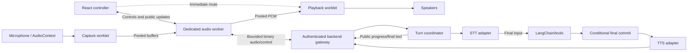

# Browser audio execution plan

Proposed design; no audio runtime, worker, worklet, SDK, or provider connection is implemented. [M2](./roadmap.md#m2-manual-voice-baseline) introduces manual recording; [M3](./roadmap.md#m3-hands-free-voice-mvp) introduces hands-free streaming. M1 needs neither. See [architecture](./architecture.md) for conversation contracts and [scaling](./scaling.md) for shared ownership/capacity.

ElevenLabs is the selected initial speech provider, behind server-only STT/TTS adapters. Select compatible models, transports, formats, voice, language coverage and retention before integration. Keep the app's silence/interruption rules authoritative. For the Scribe realtime candidate, verify `commit_strategy=manual` and `include_language_detection=true`; combine segment-final text and delayed `committed_transcript_with_timestamps` metadata into one finalized utterance. Bound metadata waiting and handle uncertain language without a second agent run. Forced provider segmentation must preserve ordered assembly and the app's finalization barrier; do not enable automatic editing/translation implicitly. Sources: [realtime API](https://elevenlabs.io/docs/api-reference/speech-to-text/v-1-speech-to-text-realtime), [events](https://elevenlabs.io/docs/eleven-api/guides/how-to/speech-to-text/realtime/event-reference).

## Planned audio paths

- **M2 baseline/fallback:** native `MediaRecorder` → bounded completed recording → backend STT → agent → final-text commit → TTS → native playback. Retain typed input; asynchronous fetch alone does not justify a worker.
- **M3 target:** `AudioWorklet` capture → dedicated worker for VAD/preparation/transport → streaming STT. Finalize after about 3 seconds of silence; run the agent once on final input, then stream TTS for committed text. Capture/transcription and synthesis/playback may overlap; speculative agent text is never spoken.

[LangChain's voice guide](https://docs.langchain.com/oss/javascript/langchain/voice-agent) illustrates the asynchronous pipeline; the app still owns final commit and cancellation.

## Hands-free conversation

- Start only on a user action and microphone permission. Show listening independently from processing/playback and provide End voice session. Keep capture active between utterances, except during secure input.
- Use audio timestamps and `silenceTimeoutMs` (default `3000`) after detected speech. New speech resets the timer; initial silence or missing transcript events cannot end an utterance.
- Seal once with `end_input`; await nonempty final STT within a deadline. Partial transcripts and provider segment-final events cannot independently invoke the agent.
- Speech before sealing extends that utterance. Confirmed speech afterward immediately flushes playback, cancels unfinished work/remaining delivery, and starts a replacement only after atomic server invalidation. Preserve committed answers; bound pending capture and pre-roll so first syllables survive admission.
- Send VAD interruption directly from worker to playback worklet; React/server work cannot delay audible stop. Main-thread Stop/End controls also mute immediately.
- Keep idle monitoring local and recycle pre-roll. Overflow fails visibly rather than dropping speech. Reopen provider connections per utterance or verify supported idle control; Scribe keepalives based on streamed silence do not justify continuously uploading idle microphone audio.
- Request supported [echo cancellation](https://developer.mozilla.org/en-US/docs/Web/API/MediaTrackConstraints/echoCancellation), inspect effective settings, and test speakers/headphones/noise. Offer a labelled manual/headphone fallback if user speech cannot be distinguished reliably.
- End-session, unmount, or fatal capture failure cancels pending voice work and releases resources. Suspension, stalled capture or device changes invalidate continuity; an unobserved gap is not silence and cannot finalize incomplete input.

## Execution boundaries

| Context | Owns | Excludes |
| --- | --- | --- |
| Main thread | React, permission/tracks, AudioContext lifecycle, user controls, compact visible updates, immediate mute | Sample processing, large conversions, secrets |
| AudioWorklet | Bounded capture/playout on audio rendering thread | Network, blocking waits/locks, large allocations, inference |
| Dedicated Worker | Required resampling/encoding, VAD/silence timing, framing, transport and playback preparation | DOM, permission UI, authoritative history |
| Backend | Authentication, turn ownership, providers, LangChain/tools, final commit, admission/cancellation | Browser microphone/rendering |
| Later backend pools | Proven CPU-heavy or independently asynchronous jobs | Every ordinary voice turn |

[Worklets](https://developer.mozilla.org/en-US/docs/Web/API/Web_Audio_API/Using_AudioWorklet) and [dedicated workers](https://developer.mozilla.org/en-US/docs/Web/API/Web_Workers_API/Using_web_workers) have separate roles. The main thread establishes their direct message channel; React receives controls, draft transcripts and throttled meters, never PCM frames. Coalesce updates and lazy-load extension UI.

[Video](./architecture.md#explanatory-videos-planned-extension) renders in a separate backend job. Explicit video playback replaces assistant audio; new speech pauses it. Microphone stop leaves the independent job intact; reset/disposal cancels it. Completed video never autoplays.

[Secure checkout](./voice-commerce.md) pauses capture, transcription forwarding and playback **before** secure fields appear. Advance the capture epoch, clear worker pre-roll/queues/timing, reject old-epoch server audio, and acknowledge pause before handoff. Resume only on valid user action with fresh continuity. Voice interruption does not undo an external transaction.

## Proposed streaming topology

The gateway is a backend module, not a separate service. Recording/SSE/audio fallback uses the same coordinator.

## Audio and transport contract

- Negotiate sample rate, channels, encoding, packet limits and playback capability. Worklet PCM follows actual `AudioContext.sampleRate`/layout, not microphone settings alone. Use stateful conversion only where required, preserving chunk continuity; [Web Audio resamples source audio to context rate](https://webaudio.github.io/web-audio-api/#MediaStreamAudioSourceNode).
- Send binary audio. Validate session/turn ID, session generation, capture epoch, format identity and ordered sequence numbers on the server. Capture, playback-attempt and backend ownership fences remain distinct.
- `end_input` names its epoch and last sequence. Within a deadline, validate every required packet and forward them in order through the adapter **before** provider commit on that ordered stream, using acknowledgements where supported. Local enqueue is insufficient. Gaps, truncation, conflicting duplicates or uncertain continuity fail as incomplete input; provider segment-final is not utterance-final.
- Resolve final language metadata before one agent invocation; support Urdu/mixed-language checks without rerunning for metadata arrival. Keep partial transcripts as drafts.
- Commit before public final text/TTS dispatch. Apply validated [delivery settings](./architecture.md#contextual-speech-delivery) afterward, separately from canonical `answer_final` text. Preserve text on audio failure; setting changes affect future answers, while speech retry creates a new playback attempt from committed text.
- Historical replay reauthorizes retained source/profile access under the current session; its source turn need not remain active. One foreground attempt exists. Replay/video replaces it and suppresses pending automatic speech from running turns; new speech/Stop invalidates that attempt without discarding canonical answers or unrelated text generation.
- Derive [visible states](./architecture.md#conversation-and-voice-state) from separate capture, processing and playback lifecycles.
- Choose supported PCM playout or a streaming decoder/container. Arbitrary compressed chunks are not independent whole files.

WebSocket is the initial candidate; it [works in workers without automatic backpressure](https://developer.mozilla.org/en-US/docs/Web/API/WebSockets_API). Keep it behind an adapter; add WebRTC only for measured requirements.

## Buffers and ownership

- Transfer a fixed pool of reusable `ArrayBuffer` blocks through ports; return ownership before reuse ([transfer semantics](https://developer.mozilla.org/en-US/docs/Web/API/Web_Workers_API/Transferable_objects)). Batch packets, not per-sample messages.
- Bound in-flight blocks, bytes, packet age, turn duration, message size, WebSocket `bufferedAmount`, server/provider queues and decoded playback duration. Use credits/windows; persistent overload fails predictably.
- Worklet callbacks never wait for workers/network/locks. Keep allocation bounded and inspect [actual render block sizes](https://developer.mozilla.org/en-US/docs/Web/API/AudioWorkletProcessor/process). Underrun emits silence/metrics; persistent underrun ends playback recoverably. Capture pool exhaustion fails the recording as incomplete.
- Profile pooled transfers first. Optional shared memory requires [secure context/cross-origin isolation](https://developer.mozilla.org/en-US/docs/Web/JavaScript/Reference/Global_Objects/SharedArrayBuffer), explicit index/ownership synchronization and compatible deployment headers; it never permits blocking the audio callback ([coordination patterns](https://developer.chrome.com/blog/audio-worklet-design-pattern/)).

## Stop, failure, and fallback

- Keep Finish input, Cancel turn, Stop playback and End session distinct. Stop/interruption immediately invalidates the affected playback epoch, mutes/disconnects output and flushes scheduled audio before waiting for worker/server acknowledgement. Keep enabled listening active; cancel remaining synthesis/delivery without deleting committed history.
- Gate packets, returned buffers and worker/worklet events by epoch; reclaim stale buffers without reactivating their stream. Server history/events/speech still require current ownership. Only the coordinator emits authorized terminal cancellation events.
- Cancel/reset/replacement atomically compare target identity and expected generation and deduplicate commands. Delayed cancellation cannot affect a successor; playback stop addresses its attempt.
- Dispose tracks, ports, worklets/workers, sockets, audio nodes, decoders and object URLs. Handle startup/crash/processor failures and repeated initialization without leaks. Detect suspended contexts/devices/page lifecycle and show explicit resume when autoplay rules require it.
- Detect unsupported streaming early; offer native recording or text. Mid-turn failure follows [retry rules](./architecture.md#failures-and-recovery), never silently replays partial audio. Reconnect queries authoritative status/replay; expired events do not authorize another agent run. Lost microphone continuity requires explicit recovery.
- Keep cancelled upstream calls counted until settled or conservatively reconciled. Bound replacement admission; isolate background narration capacity. `MediaRecorder` [timeslices vary](https://developer.mozilla.org/en-US/docs/Web/API/MediaRecorder/dataavailable_event), so enforce elapsed-time/byte limits rather than chunk-count duration or promised background capture.

## Checks before enabling streaming by default

- Compare native/streaming on supported Brave/Chromium, Safari, Firefox and lower-power hardware; establish supported versions during implementation.
- Measure long tasks/UI response, callback/worker time, pool peaks/exhaustion, underruns, buffered duration/bytes and memory after repeated start/stop.
- Measure speech end → 3-second seal → accepted input → final STT → final commit → first audio, plus interrupt-to-local-mute and direct/tool p50/p95 latency. Separate device/network/provider/agent time; correlate IDs and monotonic durations, not unsynchronized clock subtraction.
- Exercise slow/delayed transport, disconnects, provider stalls, suspension, worker crash, denied permission and unsupported codecs; verify bounded resources and cleanup.
- Verify last-packet barriers, gaps/truncation, single finalization, secure pause with in-flight audio, and direct mute during a React long task.
- Stop/reset in every stage; delay/duplicate controls across replacements; verify no stale history/audio or duplicate agent runs. Replay older answers with source/profile reauthorization, expiry and attempt isolation.
- Test silence boundaries, resumed speech around sealing, delayed final metadata, no initial-silence turns, clipped syllables, resampling/clicks, noise/echo and actual interruption.
- Test Urdu/mixed language, neutral/expressive delivery, manual overrides and unsupported-style fallback, including interruption during preparation/synthesis.

Choose performance targets and extra workers/shared memory/transports from measured bottlenecks.
