# Browser audio execution plan

Status: proposed design. No browser audio runtime, worker, or worklet is implemented yet. This extends [the system architecture](./architecture.md) while preserving the React atomic UI, backend LangChain agent, and session/turn contracts.

[Runtime and scaling design](./scaling.md) defines shared ownership, provider capacity isolation, and independent job/action lifecycles. Expensive extensions stay outside the browser audio worker and the voice runtime's event loop.

ElevenLabs is the selected initial speech provider. Use standalone speech APIs behind the backend STT/TTS adapters and keep provider credentials on the server. For streaming recognition, map the app's `end_input` to a provider commit and await the finalized transcript; keep the 3-second silence timer and interruption handling under app control. Provider-specific framing belongs in the backend adapter, while the browser/backend audio transport remains binary. Select compatible speech models and a voice during integration; no SDK or provider connection is implemented yet.

For the Scribe realtime candidate, verify/configure manual commit and language-detection events in the selected API/SDK. Normalize segment-final text and subsequent metadata into one finalized utterance; neither event may independently start the agent. Any forced provider segmentation must preserve ordered utterance assembly and the app's `end_input` barrier. Disable automatic transcript editing/translation unless explicitly introduced by the correction feature. See the [realtime API contract](https://elevenlabs.io/docs/api-reference/speech-to-text/v-1-speech-to-text-realtime) and [event reference](https://elevenlabs.io/docs/eleven-api/guides/how-to/speech-to-text/realtime/event-reference).

## Planned audio paths

1. **First working path and fallback:** native `MediaRecorder` captures a bounded recording; the backend receives the completed recording, transcribes it, runs the agent, commits the final text, and synthesizes audio for native playback. Use supported formats and retain typed input. An extra worker is unnecessary for ordinary asynchronous requests alone.
2. **Hands-free streaming target:** capture samples through an `AudioWorklet`, detect speech and transport audio in one dedicated worker, and begin STT while the user speaks. About 3 seconds of silence ends the utterance; only its final transcript starts the agent. Keep listening between utterances and interrupt replies when new user speech begins. After the answer is finalized and committed, stream TTS audio into a bounded playback buffer.

The manual path is the first integration milestone and fallback; the hands-free path is required for the intended voice experience. It overlaps capture with transcription and lets playback begin before all answer audio arrives. It does not shorten cloud inference automatically. Speculative playback of partial agent text is outside the approved design; only committed final answers are spoken.

[LangChain's voice guide](https://docs.langchain.com/oss/javascript/langchain/voice-agent) demonstrates an asynchronous STT → agent → TTS pipeline over WebSocket. Our initial streaming path keeps the planned final-answer commit boundary rather than speaking arbitrary agent tokens.

## Hands-free conversation

- **Enable listening:** start only after the user's Start voice session action and microphone permission. Keep capture and speech detection active between utterances, during processing, and during playback, except for the secure-input pause described below. Show a persistent listening indicator and an End voice session control. End-of-input releases per-utterance resources while keeping the session microphone active.
- **Detect the end of a question:** use a configurable `silenceTimeoutMs` with a default of `3000`. Count continuous observed non-speech audio after actual speech, using audio timestamps. Speech before the deadline resets the timer. Time since the last transcript event is not a silence detector; initial silence never submits input.
- **Seal once:** send one `end_input` per utterance after the silence threshold or manual finish. Await a nonempty final STT result within a bounded deadline; partial transcripts and provider segment-final messages do not independently start the agent. Empty or failed recognition produces a recoverable error. The 3-second setting ends capture for that utterance, not the entire listening session, and does not include STT/agent latency.
- **Handle new speech:** before sealing, speech extends the same utterance. After sealing, confirmed user speech starts a new turn and immediately mutes/flushes old playback. Cancel any older unfinished generation or remaining synthesis/delivery; preserve committed text/history. Atomically invalidate old server ownership before admitting the replacement. Capture locally into bounded buffers while admission is pending, and retain a short bounded pre-roll so the first syllables are not clipped.
- **Stop locally:** confirmed VAD interruption sends an invalidate/flush control directly from the audio worker to the playback worklet as well as notifying the main-thread controller. React rendering and server cancellation do not precede local audible stop. Main-thread Stop/End controls retain their immediate local mute path; the worklet discards stale playback-attempt packets.
- **Keep silence monitoring local between utterances:** do not retain or continuously upload idle microphone audio by default. Recycle the bounded pre-roll. If pending capture exceeds its limit, fail visibly rather than silently dropping speech.
- **Handle playback echo:** request supported browser [echo cancellation](https://developer.mozilla.org/en-US/docs/Web/API/MediaTrackConstraints/echoCancellation) and inspect effective settings. Validate speech detection with speakers, headphones, background noise, and different voices; browser processing alone does not guarantee correct interruption detection. If the device cannot reliably distinguish user speech from playback, offer a clearly labelled manual/headphone fallback.
- **End or interrupt the session:** End voice session, unmount, or fatal capture failure releases tracks and all audio resources and cancels pending voice work. If capture stalls or the audio context/page is suspended, invalidate capture continuity and show recovery; do not count the gap as observed silence or submit incomplete input. Resume requires a valid listening session and restored capture.

## Execution boundaries

| Execution context | Responsibility | Keep elsewhere |
| --- | --- | --- |
| Browser main thread | React UI, microphone permission, media-track lifecycle, AudioContext graph, user gestures, visible state and immediate playback stop | Per-sample processing, large audio conversions, secret provider credentials |
| AudioWorklet | Small, predictable sample capture and PCM playback operations on the audio rendering thread | Network calls, waiting for workers, large allocations, model inference |
| Dedicated Web Worker | Necessary resampling/format conversion, speech detection/VAD, silence timing, packet framing, bounded transport and playback preparation | DOM/React rendering, microphone permission UI, authoritative conversation state |
| Backend runtime | Session ownership, STT/TTS provider connections, LangChain, tools, cancellation, finalization and resource admission | Browser rendering and microphone lifecycle |
| Optional backend workers | Proven CPU-heavy server jobs or explicitly asynchronous jobs introduced later | Every interactive voice turn by default |

[AudioWorklet runs off the main thread](https://developer.mozilla.org/en-US/docs/Web/API/Web_Audio_API/Using_AudioWorklet). A [dedicated worker](https://developer.mozilla.org/en-US/docs/Web/API/Web_Workers_API/Using_web_workers) provides a different execution context and cannot manipulate the DOM. Moving audio preparation there helps UI responsiveness; it does not replace the audio rendering thread.

The main thread starts the worker and worklet and establishes their message channel. Exchange audio directly between them after setup. Send React only control events, transcript updates, and throttled level summaries; do not put raw audio frames in React state. Coalesce draft transcript/meter updates, keep them separate from committed messages, and lazy-load extension screens so rendering a document/video panel does not enlarge every voice update.

The planned [explanatory-video extension](./architecture.md#explanatory-videos-planned-extension) renders in a separate backend job. Keep video processing out of audio worklets and the live audio worker. When a user starts video playback, stop any active assistant audio first; new microphone speech must pause the tutorial immediately as well as stopping voice replies. Stopping microphone listening releases audio capture without cancelling the independently owned video job; reset or screen disposal cancels it. Video job cancellation remains a separate action, and a completed job must never autoplay into a listening session.

For [shopping and booking](./voice-commerce.md), each spoken request/clarification remains a normal turn; approval and checkout state belongs to the separate action workflow. Before secure payment/login/OTP input, stop playback and microphone capture/forwarding, invalidate pending input and its silence timer, and show the secure-input state. Resume listening only through a valid user action and current session. A pause in speech, a cloned voice, or assistant playback cannot confirm a transaction; interruption does not imply a submitted purchase was undone.

Treat secure pause as a barrier before presenting secure fields: advance the capture epoch, stop/mute capture and output, clear worker pre-roll/pending packets and silence timing, and reject old-epoch audio at the server. Acknowledge the paused state before entering the provider flow. Resume starts fresh capture continuity through a valid user action; this applies to checkout handoffs as well as direct integrations.

## Proposed streaming topology

```mermaid
flowchart LR
    subgraph Browser[Browser]
        UI[React and feature controller]
        Mic[Microphone and AudioContext]
        Capture[AudioWorklet capture]
        Worker[Dedicated audio worker]
        Output[AudioWorklet PCM playback]
        Speaker[Speakers]
        UI -.->|Permission, lifecycle, control| Mic
        Mic --> Capture
        Capture -->|Pooled sample buffers| Worker
        Worker -->|Pooled decoded PCM| Output
        Output --> Speaker
        UI <-->|Control and public updates| Worker
        UI -.->|Immediate mute and stop| Output
    end
    subgraph Server[One modular backend initially]
        Gateway[Authenticated streaming gateway]
        Coord[Turn coordinator]
        STT[Streaming STT adapter]
        Agent[LangChain and tools]
        Commit[Conditional history commit]
        TTS[Streaming TTS adapter]
        Gateway --> Coord
        Coord --> STT
        STT -->|Final utterance| Agent
        Agent -->|Final answer| Commit
        Commit -->|Committed text| TTS
        TTS -->|Ordered audio| Gateway
        Coord -->|Public progress and final text| Gateway
    end
    Worker <-->|Bounded binary audio and control| Gateway
```

The gateway is a module in the backend, not a new microservice. The HTTP recording/SSE/audio path stays available through the same coordinator. Browser workers and optional server workers solve different problems.

## Audio and transport contract

- Negotiate an explicit audio format: sample rate, channel count, encoding, packet limits, and playback capability. For worklet PCM, use the actual `AudioContext.sampleRate` and channel layout; microphone track settings alone do not define that format. Convert capture and playback rates when needed; do not assume they match the providers' rates. The [Web Audio specification](https://webaudio.github.io/web-audio-api/#MediaStreamAudioSourceNode) defines resampling of microphone source audio to the context rate.
- Resample only when required, using a stateful converter that preserves continuity across chunks. Send binary audio rather than base64 inside JSON progress messages.
- Give each stream session/turn identifiers, a session generation, capture epoch, ordered packet sequence numbers, and an explicit end-of-input marker. Keep capture epochs, playback attempts, and backend turn-owner fences distinct. Validate ownership and format on the backend before accepting audio.
- `end_input` includes the last capture sequence for that epoch and negotiated format identity. The backend processes this barrier only after validating all required packets and forwarding them through the provider adapter in order within a bounded deadline. Send provider commit after those frames on the same ordered stream, using acknowledgements where supported; local enqueue alone is insufficient. A gap, truncated buffer, duplicate conflicting packet or unknown continuity is a recoverable incomplete-input error, never a supposedly complete question. A provider segment-final message is not the app's utterance-final barrier.
- Partial transcripts update draft text only. After end-of-input and final STT output, the coordinator starts one agent run for that admitted turn. Partial revisions cannot trigger additional runs.
- Carry reliable detected-language metadata with the final transcript when available. Resolve the reply language for that utterance before invoking the agent and select supported TTS output accordingly; changing language must not trigger an extra agent run. Include Urdu and language-switching checks when evaluating adapters.
- Commit the completed answer before publishing final text or dispatching TTS. Stream synthesized audio for that committed text; preserve the answer when synthesis, transport, or playback fails.
- Apply [contextual delivery](./architecture.md#contextual-speech-delivery) in the backend adapter after final-answer commit. Keep canonical text in the existing `answer_final` event; expose only allowed delivery status/settings and synthesized audio from speech preparation. Style selection does not add sample processing to the worklet or alter the 3-second input boundary. Voice/style setting changes apply to future answers; explicit speech retries get a new playback attempt tied to the committed answer.
- An explicit replay of an older retained answer uses a fresh authorized playback attempt/current session generation with that answer as its source. It does not require the source turn to remain the active generation. Keep only one foreground playback attempt; replacement, new speech and Stop playback invalidate old audio, while any unrelated active text generation remains separately controlled. Explicit replay/video playback suppresses pending automatic speech from already-running turns under the [foreground playback rule](./architecture.md#contextual-speech-delivery).
- Keep capture, turn processing, and playback lifecycles internally distinct. Derive the public voice states defined in [the architecture](./architecture.md#conversation-and-voice-state) from them, since recording and transcription can overlap.
- Choose PCM playback through the worklet or a supported streaming decoder/container path during provider integration. Arbitrary compressed chunks are not automatically independent audio files; do not call a whole-file decoder on each chunk.

WebSocket is the initial bidirectional transport candidate. It is [available in workers but lacks automatic backpressure](https://developer.mozilla.org/en-US/docs/Web/API/WebSockets_API). Keep the transport behind an adapter; consider WebRTC only when measured media/network requirements justify its additional infrastructure.

## Buffers and ownership

- Start with a fixed pool of reusable `ArrayBuffer` blocks transferred through message ports. The sender loses access after transfer; return each buffer to its producer before reuse. [Transferable buffers move ownership without copying their memory](https://developer.mozilla.org/en-US/docs/Web/API/Web_Workers_API/Transferable_objects).
- Batch samples into negotiated packets. Avoid allocating a new message for every sample or scheduling React updates at audio callback frequency. Define maximum in-flight buffers and packet age as well as byte limits.
- Keep worklet processing bounded and allocation-light. Inspect actual input block sizes; [do not assume a permanently fixed render quantum](https://developer.mozilla.org/en-US/docs/Web/API/AudioWorkletProcessor/process).
- The audio rendering callback never waits for the worker, the network, or a lock. Return silence on playback underrun and record a metric; persistent underruns end playback with a recoverable error.
- If capture exhausts its buffer pool, stop the affected recording and report an incomplete capture. Do not silently discard spoken audio and present the resulting transcription as complete.
- Cap outbound WebSocket `bufferedAmount`, application queues, server/provider buffers, and decoded playback duration. Use an application-level credit/window protocol so senders cannot outrun processing or playback indefinitely.
- Bound maximum message size and turn duration on both ends. When limits persist, cancel or fail predictably. Merely moving an unbounded queue into a worker does not solve overload.
- Treat pooled transfers as the starting implementation, then profile. A shared ring buffer using `SharedArrayBuffer` is optional if messaging overhead proves material and deployment supports [secure context and cross-origin isolation](https://developer.mozilla.org/en-US/docs/Web/JavaScript/Reference/Global_Objects/SharedArrayBuffer).

Shared memory requires explicit ownership/index synchronization and deployment headers compatible with the app's external resources. The [Chrome audio design patterns](https://developer.chrome.com/blog/audio-worklet-design-pattern/) illustrate worklet/worker coordination; shared memory does not permit blocking the audio callback.

## Stop, failure, and fallback

- Distinguish ending an utterance (`end_input`, triggered by silence or manual finish), cancelling a turn, stopping playback, and ending the voice session. On cancellation, playback stop, or confirmed interruption, invalidate the affected turn/playback epoch immediately, mute or disconnect output, flush scheduled audio, and notify the worker. Keep an enabled session's listening capture active. Request backend cancellation of remaining work; do not wait for the worker or server before stopping audible playback.
- Correlate control messages, audio packets, and returned buffers with their stream epoch. Discard stale work in the worker and worklet as well as in React. Reclaim buffers without letting an old stream become active again.
- Backend ownership and turn-state checks still gate events, history writes, and speech dispatch. Only the coordinator may emit terminal cancellation events for the affected authorized turn. Local worker termination is not a substitute for cancelling the server turn. Stopping playback preserves already committed history.
- Backend cancellation/reset/replacement controls compare their target and expected generation atomically and deduplicate the command. A late cancel for an older turn cannot stop a newer turn; Stop playback addresses only its playback attempt. Automatic speech and explicit historical replay use their respective authorization rules above.
- Release media tracks, ports, audio nodes, pending decoders, and object URLs on exit. Handle worker startup/crash and worklet processor failure explicitly; repeated initialization must not leak live microphones or workers.
- Detect support and startup failure before beginning the streaming turn where possible. Offer the native recorded path or typed input when streaming is unavailable. A mid-turn failure requires an explicit retry following [the turn retry rules](./architecture.md#failures-and-recovery); do not silently replay partial audio or start a second agent run.
- On reconnect, recover public events/authoritative status without re-running the agent. Expired event replay requires a status lookup, not automatic resubmission. Raw live microphone capture is not automatically resumable; show a recoverable error when continuity is lost.
- Keep old cancelled upstream STT/TTS calls counted against provider capacity until they actually settle or a conservative controller policy accounts for them. Replacement capture has a bounded admission window; fail visibly if a slot cannot be acquired. Background narration uses separately limited capacity rather than consuming the entire interactive allowance.
- Detect a suspended audio context, device changes, and page lifecycle interruptions. Keep playback user-initiated when required and show a resume action if the browser blocks audio.

`MediaRecorder` remains useful for the fallback, but its [timeslice timing can vary and chunks can grow](https://developer.mozilla.org/en-US/docs/Web/API/MediaRecorder/dataavailable_event). Enforce real elapsed-time and byte limits; do not infer duration from chunk count or promise uninterrupted background capture.

## Checks before enabling streaming by default

- Compare native recording with worker/worklet streaming on the supported Brave/Chromium, Safari, and Firefox versions, including a lower-power device. Establish the browser support list during implementation.
- Measure main-thread long tasks, UI response while recording, audio callback overruns, worker processing duration, pool exhaustion, playback underruns, peak buffered bytes/audio duration, and memory after repeated start/stop cycles.
- Measure end-of-speech to final transcript, final text, and first audible audio separately; report p50/p95 for direct answers and tool-assisted answers. Distinguish device, network, provider, and agent time.
- Record observed speech end, 3-second utterance seal, accepted final input, final STT, final-answer commit and first audible audio separately, plus confirmed-interruption-to-local-mute. Use monotonic durations on each device/process and correlate IDs across browser/server rather than subtracting unsynchronized clocks.
- Exercise slow upload/download, packet delays, disconnects, provider stalls, tab suspension, worker crash, denied permission, and unsupported codecs. Verify all buffers remain within configured limits.
- Verify `end_input` waits for its last packet, rejects gaps/truncation, and cannot finalize twice. Exercise secure pause while audio is in flight; no old capture enters the provider flow after the barrier. Confirm direct worker/worklet stop still works while React has a long task.
- Stop and reset during capture, transcription, tools, synthesis, and playback. Verify no stale audio resumes, no duplicate agent runs appear, and backend history obeys the same conditional-commit rules.
- Delay and duplicate cancel/stop commands across a replacement turn. Replay an older committed answer after a newer turn and verify attempt isolation, new-speech interruption, expired-answer rejection and profile reauthorization without an agent/tool rerun.
- Verify silence shorter than 3 seconds continues the same utterance, silence reaching the threshold seals it once, and initial silence creates no turn. Test new speech immediately before/after submission, delayed final STT, and page suspension.
- Listen for clipping, resampling artifacts, chunk-boundary clicks, and speaker echo on actual hardware. Verify user speech interrupts processing and playback without stale audio returning or losing the first syllables; background noise and TTS leakage must not trigger new turns.
- Compare neutral and expressive presets for Urdu/mixed-language pronunciation, first-audio latency, clipping, volume variation, and speaker echo. Verify manual override, unsupported-style fallback, and interruption during style preparation and synthesis; old speech must not restart.

Set performance targets from these measurements and the selected providers. Add more workers, shared memory, or alternate transports only when a measured bottleneck or required capability supports the change.
